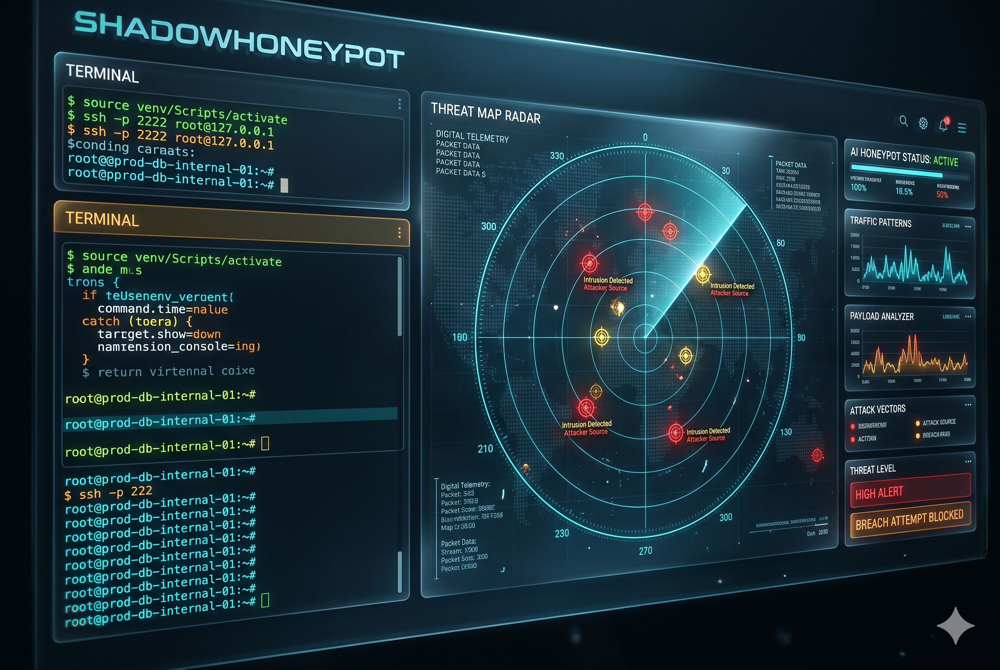
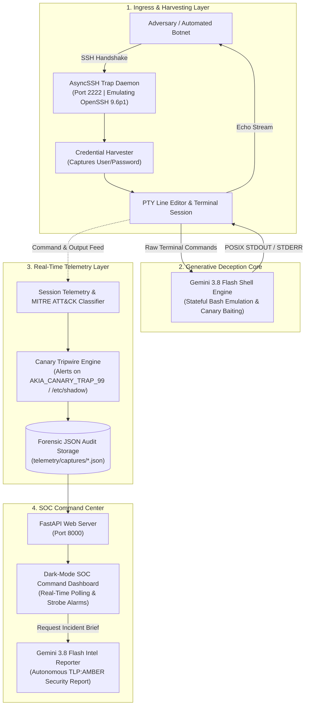

<p align="center">
  
</p>

# 🛡️ ShadowHoneypot
### Autonomous AI-Driven Adversary Deception Network & Incident Response Platform
*Built for Hackathon Deception & Defense | Powered by Google Gemini 3.8 Flash*

<p align="center">
  <a href="#license"></a>
  <a href="https://python.org"></a>
  <a href="https://aistudio.google.com"></a>
  <a href="https://attack.mitre.org"></a>
  <a href="https://fastapi.tiangolo.com"></a>
</p>

---

## 💡 Inspiration
Traditional honeypots have a fatal flaw: **low-interaction honeypots** rely on rigid, static command scripts that modern threat actors and automated botnet scanners detect within seconds. Attackers immediately notice broken POSIX pipes, missing flags, non-standard outputs, or unrealistic responses. On the other hand, maintaining **full-interaction isolated virtual machines** requires continuous patching, poses severe sandbox breakout / escape risks, and buries security analysts under heaps of unstructured log noise.

We asked ourselves:
> **"What if an attacker wasn't breaking into an operating system, but rather an isolated, generative POSIX simulation that dynamically wastes their time, baits them with honey-tokens, and autonomously turns their tactics into actionable CISO-level threat intelligence?"**

That vision led directly to the birth of **ShadowHoneypot**.

---

## 🎯 What It Does
ShadowHoneypot is an end-to-end autonomous cyber deception and incident response platform:

- 🧠 **Zero-AI-Leak Bash Simulation:** Simulates an authentic enterprise Ubuntu 24.04 LTS database server (`prod-db-internal-01`). The shell handles command history, pipes, directory traversal, exit codes, and realistic POSIX error streams without breaking character or leaking conversational AI disclaimers.
- 🪤 **Dynamic Canary Token Baits:** Deliberately places deceptive high-value assets across the simulated filesystem (salted `/etc/shadow` hashes, developer history with canary AWS keys `AKIA_CANARY_TRAP_99`, database dumps) to lure attackers into revealing their intentions.
- 🗺️ **Real-Time MITRE ATT&CK Mapping:** Every command is classified on the fly against the enterprise Linux matrix (e.g., `T1033 User Discovery`, `T1082 System Info Discovery`, `T1552.003 Bash History Credentials`, `T1003.008 Shadow Dumping`), calculating a dynamic 0–100 threat score.
- 🚨 **Canary Tripwire Strobe Alert:** As soon as an adversary touches or `cat`s an injected canary secret, the system instantly triggers an alert with **Threat Score: 100/100 [CRITICAL]** and flashes real-time strobe alarms on the SOC dashboard.
- 📄 **Autonomous Incident Intelligence Reports:** With a single click, **Gemini 3.8 Flash** synthesizes raw session telemetry into an executive **TLP:AMBER** security intelligence report featuring an attack chain timeline, adversary methodology, IOC tables, and hardened remediation commands.
- 🖥️ **Dark-Mode SOC Command Center:** A FastAPI and Tailwind-powered glassmorphism dashboard providing live attack feed polling, MITRE tactic badges, and session deep-dives.

---

## 🏗️ Architecture & System Flow

```text
+-------------------------------------------------------------------------------+
|                       ADVERSARY / BOTNET RECONNAISSANCE                       |
+-------------------------------------------------------------------------------+
                                        |
                       [SSH Port 2222: Fake OpenSSH 9.6p1]
                                        v
+-------------------------------------------------------------------------------+
|                         ASYNCHRONOUS SSH TRAP DAEMON                          |
|  • Credential Harvesting (Captures user/pass: root:admin123)                  |
|  • Non-blocking PTY terminal emulation with live keystroke echoing            |
+-------------------------------------------------------------------------------+
                     |                                       |
             (Raw Keystrokes)                         (Raw Commands)
                     v                                       v
+---------------------------------------+   +---------------------------------------+
|     GEMINI 3.8 FLASH SHELL ENGINE     |   |      REAL-TIME TELEMETRY ENGINE       |
|  • Low-latency POSIX simulation       |   |  • MITRE ATT&CK taxonomy classifier   |
|  • Zero AI conversational leaks       |   |  • Canary token tripwire detector     |
|  • Realistic Ubuntu 24.04 outputs     |   |  • Dynamic threat scoring (0-100)     |
|  • Injected AWS canary secrets        |   |  • Forensic JSON audit persistence    |
+---------------------------------------+   +---------------------------------------+
                     \                                       /
                      \                                     /
                       v                                   v
+-------------------------------------------------------------------------------+
|                   FASTAPI SOC DASHBOARD & INTELLIGENCE API                    |
|  • Real-time attack feed auto-refresh (Live glass pane)                       |
|  • Canary exfiltration strobe alarm                                           |
|  • One-Click Autonomous Incident Intelligence Report via Gemini 3.8 Flash      |
+-------------------------------------------------------------------------------+
```

### Flow Breakdown


---

## 🛠️ How We Built It
- **Core AI Deception Engine:** Built in Python using the official Google GenAI SDK (`google-genai`). We engineered a strict POSIX behavioral prompt for `gemini-3.8-flash` with zero-budget low-latency configuration (`thinking_level="low"`), ensuring authentic bash execution and sub-second terminal response times.
- **Asynchronous Trap Daemon:** Built on `asyncssh` and `asyncio`, mimicking an authentic OpenSSH 9.6 banner and authentic Ubuntu MOTD. The daemon offloads LLM processing to non-blocking worker threads to maintain responsive PTY keystroke echoing and multi-line command safety.
- **Threat Scoring & Taxonomy:** Developed an in-memory telemetry analyzer tracking the MITRE ATT&CK matrix and cross-referencing commands against known honeypot canary strings.
- **SOC Web Dashboard:** Developed using FastAPI, Uvicorn, and a responsive Tailwind CSS / JetBrains Mono glassmorphism UI that automatically polls session changes and renders rich markdown security briefs.
- **Containerization:** Packaged with `Dockerfile` and `docker-compose.yml` for unified, single-command deployment.

---

## ⚡ Challenges We Ran Into
- **PTY Keystroke Echoing & Asyncio Deadlocks:** Early prototypes faced terminal freezing when multi-line commands were pasted, because synchronous network calls blocked the asyncio event loop. We resolved this by isolating the shell engine execution inside `asyncio.to_thread` and leveraging AsyncSSH's native line editor with PTY support.
- **Eliminating AI Conversational Leakage:** Large language models naturally want to be helpful assistants. Getting Gemini to operate strictly as an Ubuntu 24.04 kernel—returning raw STDOUT/STDERR with exact error formats (`command not found`) and authentic salted password hashes without any conversational filler—required rigorous behavioral prompt refinement.
- **Transitioning to Gemini 3.8 Flash:** When older endpoints were deprecated, we seamlessly migrated to the latest Gemini 3.8 Flash architecture, adjusting latency settings to retain high throughput.

---

## 🏆 Accomplishments That We're Proud Of
- 🎯 **Hyper-Realistic Emulation:** Emulating bash so convincingly that a tester or exploit scanner cannot distinguish the environment from a real production machine.
- ⚡ **Dual-Role Gemini Orchestration:** Building a dual-mode application for Gemini: using it both at runtime as an interactive shell engine and post-exploitation as a cybersecurity threat analyst.
- 🛡️ **Zero-Cost Defense Stack:** Creating a zero-cost, fully functional deception stack that small businesses can deploy in minutes without expensive enterprise SIEM licenses.

---

## 📚 What We Learned
- Advanced asynchronous network programming and how PTY (Pseudo-Terminal) sessions handle keystroke buffering and CRLF transformations.
- How to structure deception traps to capture early attacker intent through canary tokens before lateral movement occurs.
- How to prompt and optimize modern LLMs for deterministic system emulation rather than conversational chat.

---

## 🔮 What's Next for ShadowHoneypot
- 📂 **Dynamic File Injection:** Allowing defenders to upload custom proprietary files that the engine automatically seeds with honeypot canary tokens.
- 🔔 **Automated Webhooks:** Instant Slack, Discord, and PagerDuty alerts triggered the millisecond a critical canary token is accessed.
- 🌐 **Multi-Protocol Deception:** Expanding beyond SSH to simulate vulnerable Redis, MongoDB, and Docker daemon API ports.

---

## 🚀 Quickstart Guide

### Prerequisites
- Python 3.12+
- Google Gemini API Key ([Google AI Studio](https://aistudio.google.com/))
- Docker & Docker Compose *(optional)*

### 1. Setup & Environment
```bash
# Clone the repository
git clone https://github.com/prabhattopi/shadow-honeypot.git
cd shadow-honeypot

# Create virtual environment
python -m venv venv
source venv/bin/activate  # On Windows: .\venv\Scripts\activate

# Install dependencies
pip install -r requirements.txt

# Configure environment variables
cp .env.example .env
```

Your `.env.example` file contains:
```env
# Google Gemini API Key (Get yours at https://aistudio.google.com/)
GEMINI_API_KEY=your_gemini_api_key_here

# Model Architecture (Default: gemini-3.8-flash for low-latency POSIX simulation)
GEMINI_MODEL="gemini-3.8-flash"

# Honeypot Emulated Host Identity
HONEYPOT_HOSTNAME="prod-db-internal-01"
HONEYPOT_USER="root"
```

### 2. Single-Command Deployment (Docker Compose)
```bash
docker compose up --build
```

### 3. Local Execution (Development Mode)
```bash
# Terminal 1 - Launch Honeypot SSH Trap Daemon (Port 2222)
python daemon/ssh_server.py

# Terminal 2 - Launch SOC Command Center Dashboard (Port 8000)
python -m uvicorn dashboard.app:app --host 127.0.0.1 --port 8000 --reload
```

- **Attacker SSH Trap:** `ssh -p 2222 root@127.0.0.1` *(accepts any password, records credentials)*
- **SOC Analyst Dashboard:** `http://127.0.0.1:8000`

---

## 🛡️ Telemetry & MITRE ATT&CK Matrix

| Technique ID | Technique Name | Tactic | Threat Weight |
|---|---|---|---|
| **T1078.001** | Valid Accounts: Default Accounts | Initial Access | Initial Catch |
| **T1033** | System Owner/User Discovery (`whoami`, `id`) | Discovery | 10 pts |
| **T1082** | System Information Discovery (`uname -a`, `hostname`) | Discovery | 10 pts |
| **T1057** | Process Discovery (`ps`, `top`, `htop`) | Discovery | 10-15 pts |
| **T1049 / T1016** | Network Connections & Config Discovery (`ip`, `netstat`, `ss`) | Discovery | 15-20 pts |
| **T1083** | File & Directory Discovery (`ls -la`, `find`) | Discovery | 5-15 pts |
| **T1552.003** | Unsecured Credentials: Bash History (`cat .bash_history`) | Credential Access | 35 pts |
| **T1003.008** | OS Credential Dumping (`/etc/shadow`) | Credential Access | 40 pts |
| **T1552.001** | Cloud Credentials In Files (`/root/.aws/credentials`) | Credential Access | 45 pts |
| **T1105** | Ingress Tool Transfer (`curl`, `wget`) | Command and Control | 25 pts |
| **T1048** | Exfiltration Over Alternative Protocol (`scp`, `nc`) | Exfiltration | 35 pts |

---

## 📄 License
This project is licensed under the **MIT License** - see the [LICENSE](LICENSE) file for details.
